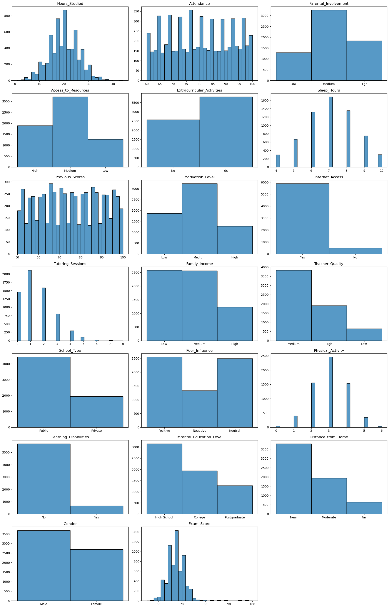
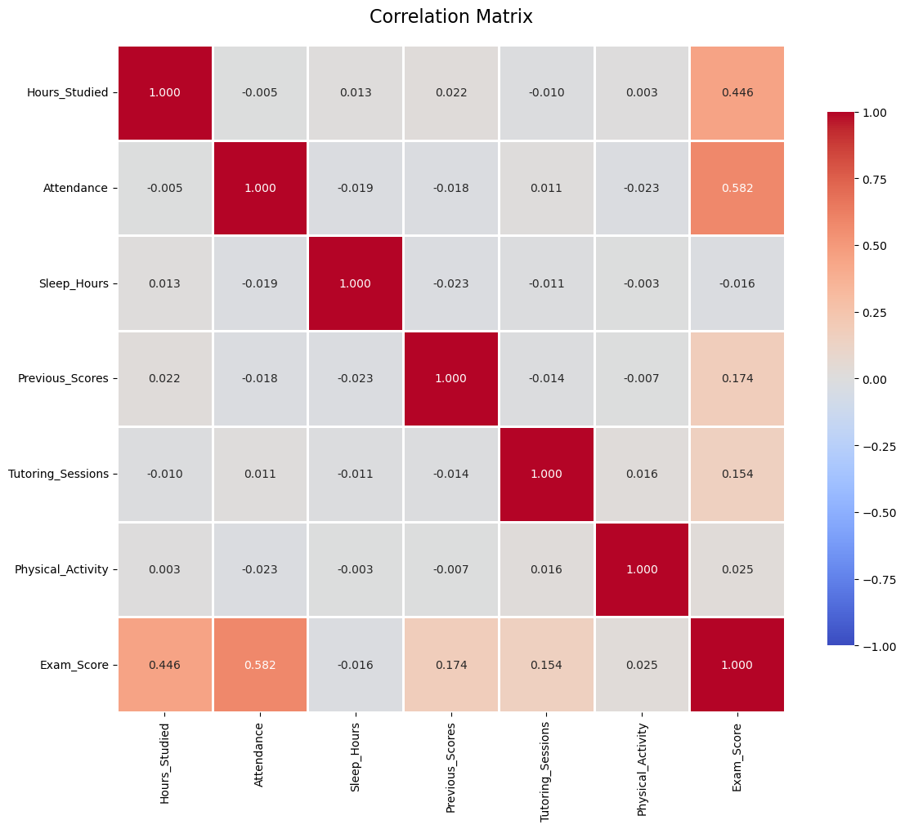
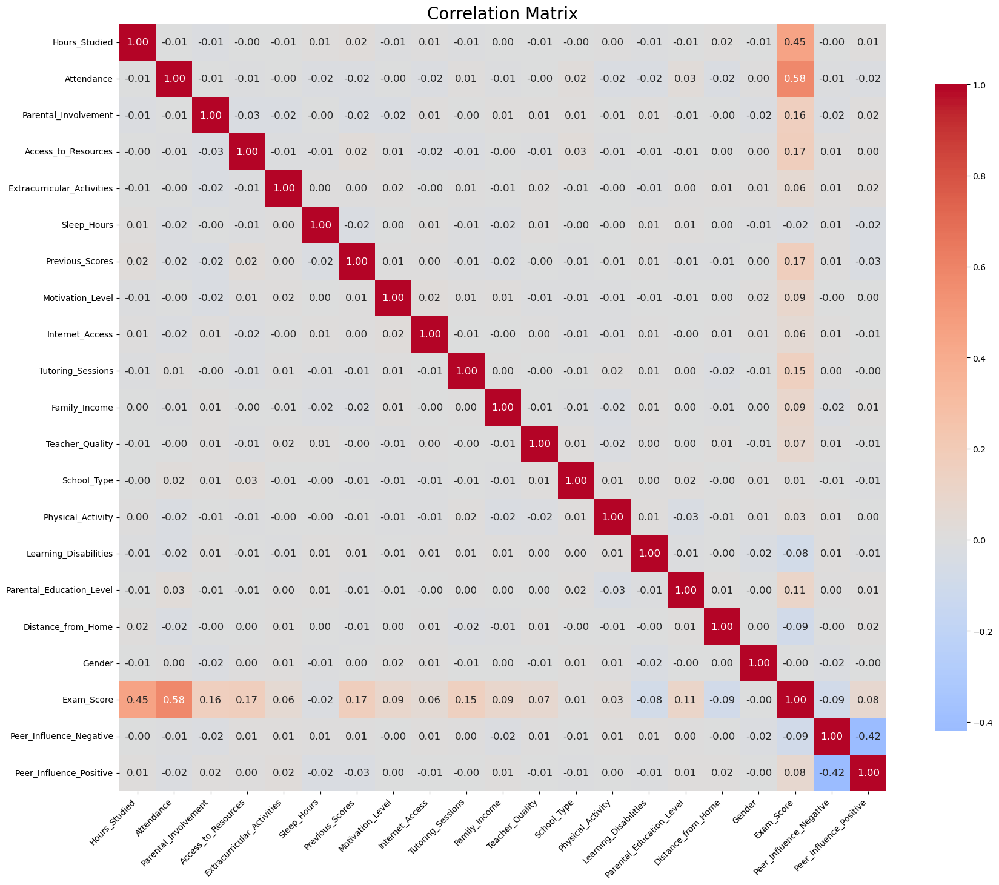
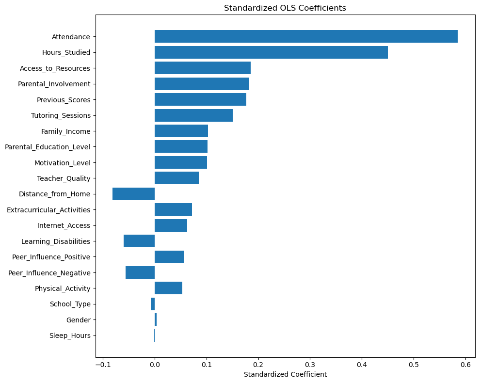
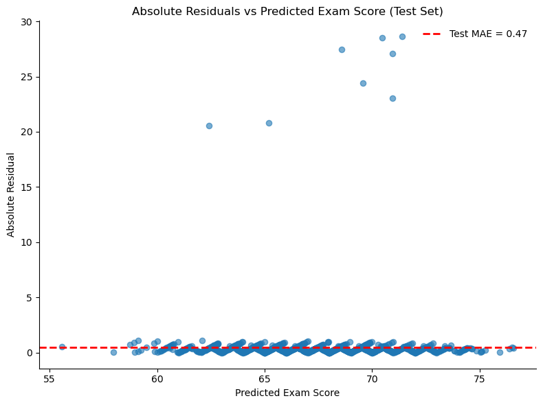

# Predictors of Academic Performance

**A multivariate regression analysis of student exam scores**

Which factors — study habits, family background, school characteristics — actually
predict how well a student performs? And how accurately can exam scores be predicted
from them?

---

## Data

*Student Performance Factors* — 6,607 students, 20 variables covering four broad areas:

| Area | Variables |
|---|---|
| Study behaviour | Hours studied, attendance, tutoring sessions, previous scores |
| Family context | Parental involvement, family income, parental education, distance from home |
| School context | Teacher quality, school type, access to resources, internet access |
| Individual | Motivation, sleep hours, physical activity, extracurriculars, peer influence, learning disabilities, gender |

**Target:** `Exam_Score` (0–100)
**Stack:** `pandas` · `statsmodels` · `scikit-learn` · `seaborn` · `matplotlib`

---

## Step 1 — Data cleaning

### Missing values

Concentrated in three categorical columns:

| Column | Missing |
|---|---|
| Parental_Education_Level | 90 |
| Teacher_Quality | 78 |
| Distance_from_Home | 67 |

Total: 235 missing values across 229 rows — **3.56%** of observations. Since they were
spread thinly rather than clustered in a single variable, listwise deletion was preferred
to imputation: dropping 3.5% of rows costs little, while imputing categorical values
would inject artificial structure into predictors that go straight into the model.

### Domain validation

One record reported an `Exam_Score` of **101**, outside the nominal 0–100 scale. This is
a measurement error rather than a genuine extreme value, so the row was removed. No
duplicate rows were found.

**Result: 6,377 usable observations.**

---

## Step 2 — Exploratory analysis

### 2.1 Descriptive statistics

| Variable | Mean | S.D. | Min | Max |
|---|---|---|---|---|
| Hours Studied | 19.98 | 5.99 | 1 | 44 |
| Attendance (%) | 80.02 | 11.55 | 60 | 100 |
| Sleep Hours | 7.04 | 1.47 | 4 | 10 |
| Previous Scores | 75.06 | 14.40 | 50 | 100 |
| Tutoring Sessions | 1.49 | 1.23 | 0 | 8 |
| Physical Activity | 2.97 | 1.03 | 0 | 6 |
| **Exam Score** | **67.25** | **3.89** | **55** | **100** |

The target variable is unusually tight: a standard deviation of under 4 points on a
100-point scale, with half the students falling between 65 and 69. This matters for
interpreting the error metrics later — the model is predicting a narrow target.



### 2.2 Correlations among numeric variables



Ranked by correlation with exam score:

| Variable | r |
|---|---|
| Attendance | **0.582** |
| Hours Studied | **0.446** |
| Previous Scores | 0.174 |
| Tutoring Sessions | 0.154 |
| Physical Activity | 0.025 |
| Sleep Hours | −0.016 |

Two variables dominate; sleep and physical activity show essentially no bivariate
relationship with performance.

### 2.3 Encoding categorical variables

Ordinal variables (Low/Medium/High, education level, distance) were mapped to 1–2–3,
preserving their natural ordering. Binary variables were coded 0/1. `Peer_Influence` has
no inherent order, so it was expanded into dummies with **Neutral as the reference
category**.



---

## Step 3 — Multivariate regression (OLS)

An 80/20 train-test split (`random_state=42`) gives 5,101 training and 1,276 test
observations. All 20 predictors were entered simultaneously.

**Train R² = 0.723 · Adjusted R² = 0.722 · F = 662.4 · p < 0.001**

### Significant predictors

| Variable | Coefficient | t | p |
|---|---|---|---|
| Access to Resources | 1.024 | 25.02 | <0.001 |
| Parental Involvement | 1.020 | 24.63 | <0.001 |
| Internet Access | 0.921 | 8.48 | <0.001 |
| Extracurricular Activities | 0.570 | 9.75 | <0.001 |
| Motivation Level | 0.559 | 13.64 | <0.001 |
| Teacher Quality | 0.548 | 11.53 | <0.001 |
| Family Income | 0.536 | 13.93 | <0.001 |
| Parental Education Level | 0.511 | 13.84 | <0.001 |
| Tutoring Sessions | 0.476 | 20.37 | <0.001 |
| Peer Influence (positive) | 0.453 | 7.03 | <0.001 |
| Hours Studied | 0.292 | 60.95 | <0.001 |
| Physical Activity | 0.198 | 7.17 | <0.001 |
| Attendance | 0.196 | 79.09 | <0.001 |
| Previous Scores | 0.048 | 23.85 | <0.001 |
| Learning Disabilities | −0.760 | −8.11 | <0.001 |
| Peer Influence (negative) | −0.537 | −6.92 | <0.001 |
| Distance from Home | −0.468 | −10.98 | <0.001 |

### Non-significant predictors

| Variable | Coefficient | p |
|---|---|---|
| Sleep Hours | −0.003 | 0.880 |
| School Type | −0.062 | 0.322 |
| Gender | 0.028 | 0.626 |

Neither gender nor public-vs-private schooling explains variation in exam scores once the
other factors are controlled for. Sleep hours likewise contributes nothing — consistent
with its near-zero bivariate correlation.

---

## Step 4 — Which predictors matter most?

Raw coefficients are not comparable: a one-unit change in `Attendance` (one percentage
point) is not equivalent to a one-unit change in `Parental_Involvement` (one ordinal
level). Standardising all variables puts them on a common scale, so the coefficients can
be ranked directly.



| Rank | Variable | Standardized β |
|---|---|---|
| 1 | Attendance | **0.586** |
| 2 | Hours Studied | **0.451** |
| 3 | Access to Resources | 0.185 |
| 4 | Parental Involvement | 0.182 |
| 5 | Previous Scores | 0.177 |
| 6 | Tutoring Sessions | 0.151 |
| 7 | Family Income | 0.103 |
| 8 | Parental Education Level | 0.102 |
| 9 | Motivation Level | 0.101 |
| 10 | Teacher Quality | 0.085 |

The ranking is decisive: **attendance and hours studied dwarf everything else**. Every
other predictor, though statistically significant, has a standardized effect at least
three times smaller — a useful reminder that statistical significance and practical
importance are different questions.

---

## Step 5 — Model evaluation

| Metric | Train | Test |
|---|---|---|
| MAE | 0.49 | **0.47** |
| MSE | 4.16 | **4.15** |
| RMSE | 2.04 | **2.04** |
| R² | 0.723 | **0.735** |
| Adjusted R² | 0.722 | **0.731** |

Test performance matches or slightly exceeds train performance on every metric — the
model is not overfitting and generalises cleanly to unseen data.



A mean absolute error of under half a point on a 100-point scale looks remarkably good.
It should be read alongside the fact that exam scores have a standard deviation of under
4 points: predicting a narrow target makes small absolute errors easier to achieve than
they would be on a more dispersed outcome.

---

## Limitations

- **Residuals are far from normal.** Skewness is 11.3 and kurtosis 137.5, driven by a
  small group of students scoring above 90 in a distribution centred on 67. Coefficient
  estimates remain unbiased, but the standard errors — and therefore the p-values above —
  should be treated with caution. Heteroscedasticity-robust standard errors would be the
  natural fix.
- **Condition number is 1.62e+03**, high enough that `statsmodels` flags possible
  multicollinearity. A VIF check would confirm whether it is a genuine problem or an
  artefact of unscaled predictors — notably, the standardized model reports a condition
  number of 1.58, which points to the latter.
- **Ordinal encoding imposes equal spacing.** Treating Low/Medium/High as 1/2/3 assumes
  the gap between Low and Medium equals the gap between Medium and High — a convenient
  assumption, not a verified one.
- **These are associations, not causal effects.** Attendance predicts performance, but
  the data cannot separate attendance causing better scores from both being driven by an
  unobserved factor such as engagement or health.

## Next steps

- Drop the three non-significant regressors and compare adjusted R²
- Test non-linear specifications (diminishing returns to study hours are plausible)
- Add interaction terms — for example, whether tutoring compensates for low parental
  involvement
- Re-estimate with heteroscedasticity-robust standard errors

---

## Repository contents

```
Student_performance_factors_analysis.ipynb   Full analysis notebook
StudentPerformanceFactors.csv                Source dataset
images/                                      Figures used in this README
```

## Reproducing

```bash
pip install pandas numpy statsmodels scikit-learn seaborn matplotlib
jupyter notebook Student_performance_factors_analysis.ipynb
```
